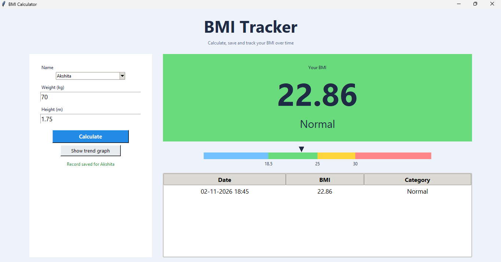
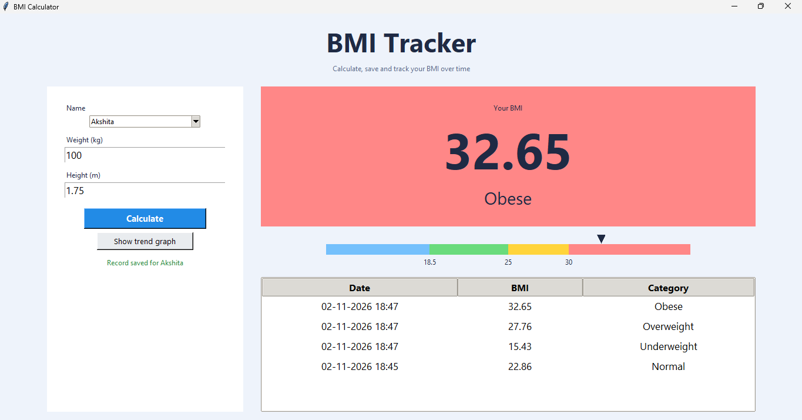
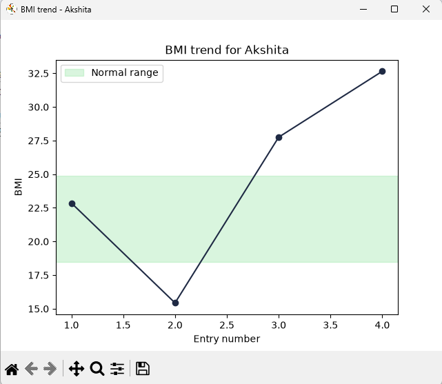

# BMI Tracker

A desktop BMI calculator built with Python, tkinter, SQLite and matplotlib.

## How to run
pip install matplotlib
python bmi_gui.py

A simple command-line version is also included: python bmi_simple.py

## Features
- Labelled input fields for name, weight (kg) and height (m)
- BMI formula: weight / height squared
- Colour-coded result card: Underweight, Normal, Overweight, Obese
- BMI scale bar with a marker showing your position
- Multiple users, chosen from a dropdown
- Records saved in an SQLite database, shown in a table
- BMI trend graph for each user (matplotlib)
- Input validation and database error handling

## Note
This tool is for learning purposes and is not medical advice.

## Screenshots

