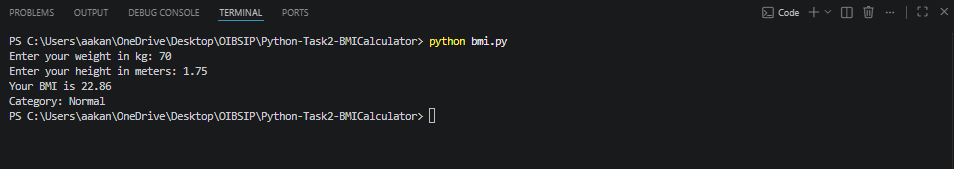
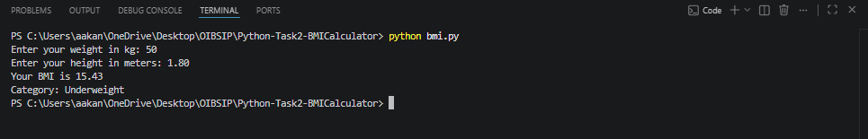
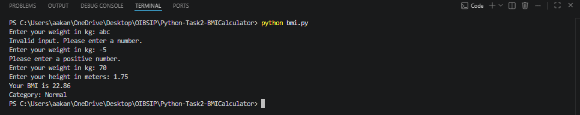

# BMI Calculator

A command-line BMI calculator built with Python.

## How to run
python bmi.py

## Formula
BMI = weight (kg) / height (m)²

## Categories
- Underweight: below 18.5
- Normal: 18.5 to 24.9
- Overweight: 25 to 29.9
- Obese: 30 and above

## Features
- Input validation for non-numeric and negative values
- Result rounded to 2 decimal places

## Screenshots

