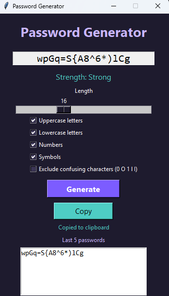
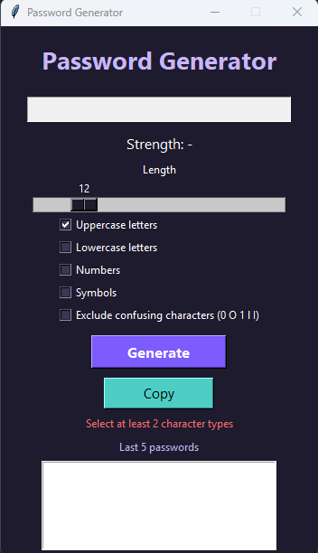
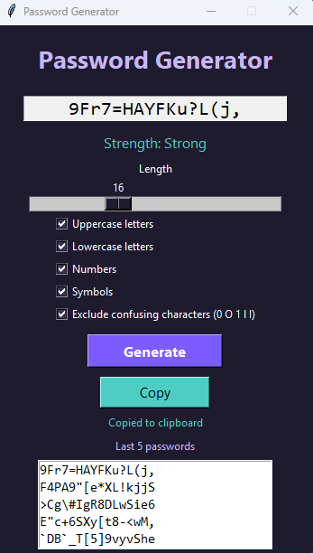

# Random Password Generator

A desktop password generator built with Python and tkinter.

## How to run
pip install pyperclip
python password_gui.py

A simple command-line version is also included: python password_simple.py

## Features
- Length slider (8 to 32 characters)
- Choose uppercase, lowercase, numbers and symbols (at least 2 types required)
- Uses the secrets module for secure random generation
- Guarantees at least one character from every selected type
- Password strength indicator: Weak, Medium, Strong
- Copies the password to the clipboard automatically (pyperclip)
- Option to exclude confusing characters (0, O, 1, l, I)
- History of the last 5 passwords, kept only in memory and never saved to a file

## Privacy
Passwords are generated on your computer and are not stored or sent anywhere.

## Screenshots

